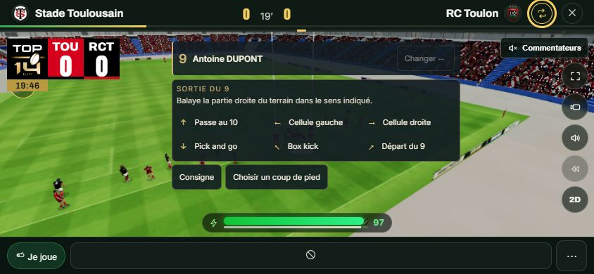
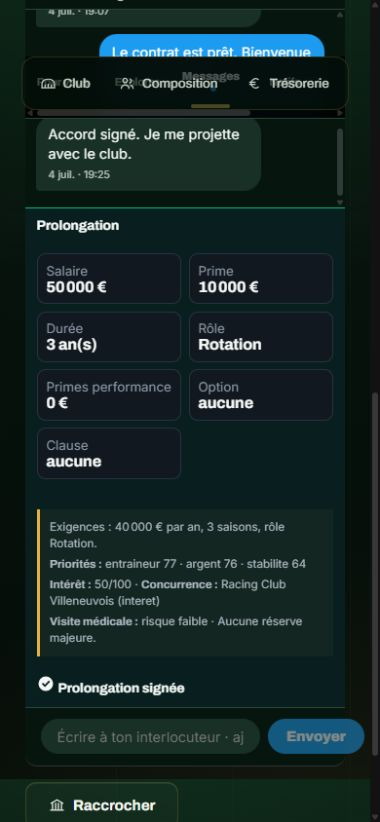

# Validation des correctifs 36 et 37

Vérification locale du 11 octobre 2026.

Les playoffs progressent de 4 à 64 clubs uniquement à partir des résultats joués. Les tests couvrent les divisions de
Régionale à Nationale, les dates, les qualifications, les doubles appels, les sauvegardes anciennes et la réparation sur
copie. Les prolongations couvrent les propositions modifiables, les réponses, les termes signés et persistés, puis les
départs libres sans renouvellement automatique.

Le contrôle du XV en Carrière Entraîneur couvre la sélection des vrais joueurs, les responsabilités, les cellules avant
la sortie du ballon, les réceptions en mouvement, les six sorties du 9, les deux camps, les phases statiques, les consignes
et les gestes défensifs. Les combinaisons sont vérifiées avec les touches remappées, les deux ordres d'appui à la manette
et l'absence de passe ordinaire supplémentaire au relâchement. Les balayages distinguent les six options et ignorent les taps.

| Vérification | Résultat |
| --- | --- |
| `verify:correctif36` | 342 contrôles validés |
| `verify:correctif37` | 126 contrôles validés |
| `verify:tournoi-final` | 83 contrôles validés |
| `verify:controle-direct` | 52 contrôles validés |
| `verify:responsabilites` | 1 455 contrôles validés |
| `verify:traductions` | 9 789 clés, sept langues, aucune erreur |
| Vérification TypeScript | Réussie |
| Analyse du code avec Oxlint | Aucune erreur |
| Construction de production | Réussie ; avertissement de taille de certains fichiers |
| Comparaison du moteur historique | Quatre simulations de 2 200 pas : états complets strictement identiques à HEAD sans activation solo |

Les bancs TypeScript ont été exécutés avec le chargeur local de secours `scripts/chargeurTests36.mjs`, sans charger
de clés ni de services distants. Les commandes `verify:*` restent disponibles dans `package.json`.

Dans le navigateur, les écrans réels ont été vérifiés sur ordinateur et aux dimensions mobiles en portrait et paysage.
Une offre personnalisée de prolongation a été acceptée et finalisée dans une carrière d'essai en mémoire : salaire
50 000 €, durée trois saisons, prime 10 000 €, prime de match 500 €, rôle Rotation. Le budget et le contrat signé se
mettent à jour. Les sauvegardes personnelles ne sont pas utilisées par les pages d'aperçu.

Les commandes et les gestes ont des tests automatisés ; l'essai sur un téléphone physique et une manette physique reste
à effectuer.

## Deux échecs déjà présents dans la version de référence

- `verify:saison-manager` valide l'avancement, les promotions, les titres, l'accès, le rechargement des résultats,
  l'élimination et la relégation, puis échoue sur « Un petit club doit pouvoir voir les jeunes de son école ».
  L'absence de jeune local pour Association Rugby Technologie est également reproduite en créant ce manager avec
  les sources de HEAD, sans les correctifs 36 et 37.
- `verify:sante-contrats` échoue sur le taux de conclusion des approches de clubs : 10 accords sur 13 pour un seuil
  de 80 %. Le même banc exécuté avec les sources de HEAD échoue au même endroit, avec les mêmes nombres.

Ces assertions sont conservées. Les deux bancs généraux ne sont pas annoncés comme réussis.

## Captures des aperçus

